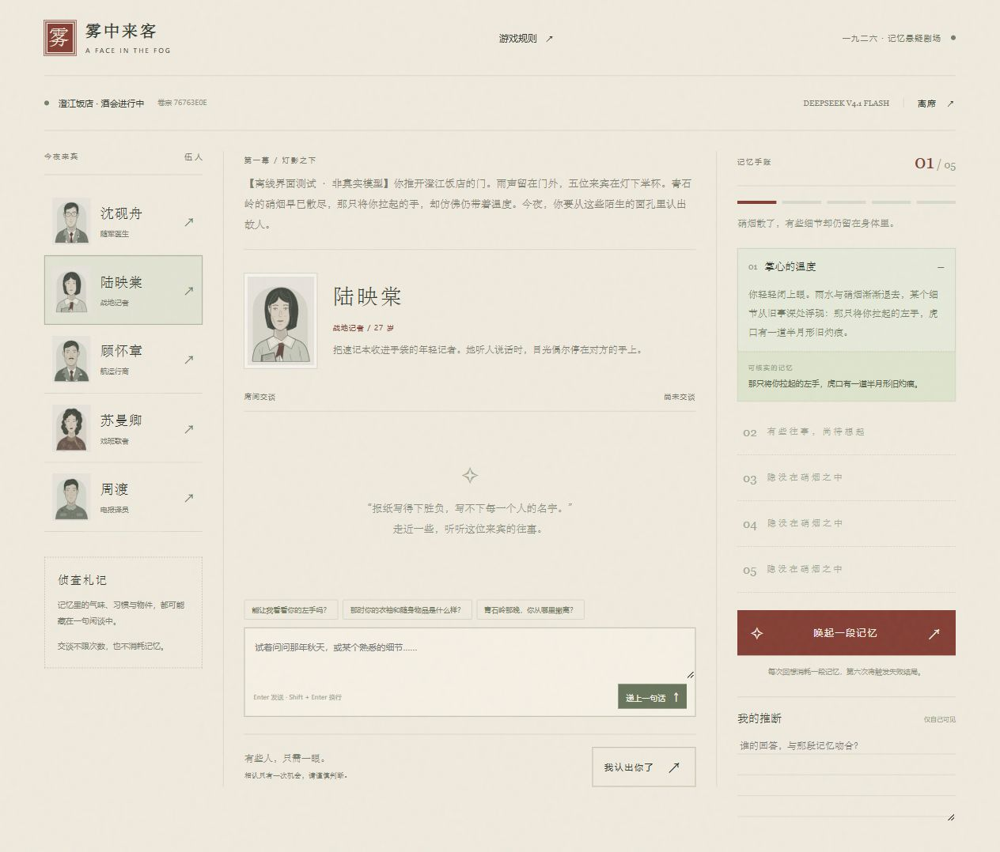
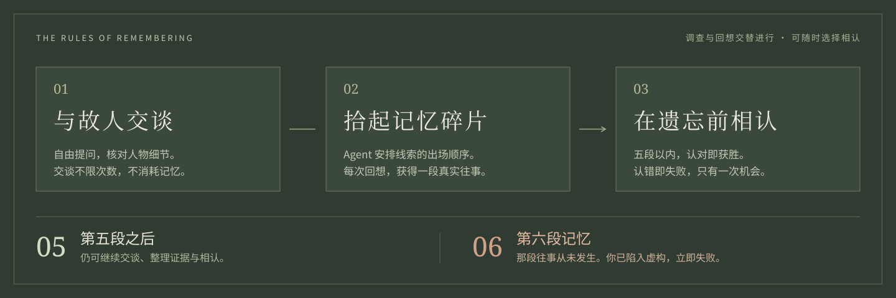
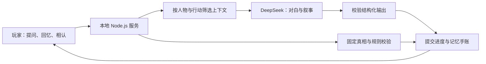

<p align="center">
  
</p>

<p align="center">
  <strong>一款由 DeepSeek 主持的民国剧情推理游戏</strong><br />
  与陌生人交谈，在残存的记忆里，认出那只曾经伸向你的手。
</p>

<p align="center">
  <code>中文互动叙事</code> &nbsp; <code>Node.js 22+</code> &nbsp; <code>零第三方依赖</code> &nbsp; <code>自带 API Key</code>
</p>

<p align="center">
  <a href="#preview">界面预览</a> ·
  <a href="#start">立即入席</a> ·
  <a href="#guests">来宾档案</a> ·
  <a href="#rules">记忆法则</a> ·
  <a href="#agent">Agent 幕后</a>
</p>

---

> **1926 年，临江。**
>
> 军阀混战，你在青石岭险些丧命。危急时，有人将你拖离火线，随即消失在硝烟里。
>
> 数月后，一封请柬将你带到澄江饭店。五位来宾各怀往事，其中一位，就是你的救命恩人。
>
> 你只有五段可信的记忆。第六段，或许从未发生。

| 自由交谈 | 有迹可循 | 每局不同 |
| :--- | :--- | :--- |
| 用自己的话提问，听来宾讲述经历。 | 将记忆碎片与人物证词交叉核对。 | 恩人与证据配置重新随机，本局真相始终固定。 |

<a id="preview"></a>

## 灯影之下，故事开场

人物档案在左，席间交谈居中，记忆手账在右。每一次回想，都会留下能够反复核对的线索。



<p align="center"><sub>实际游戏界面 · 使用离线演示数据截图 · 不展示最终答案</sub></p>

<details>
<summary><strong>展开首页预览：一封来自澄江饭店的请柬</strong></summary>


</details>

<a id="start"></a>

## 今夜，邀你入席

准备 **Node.js 22 或更高版本**，以及一个有可用额度的 [DeepSeek API Key](https://platform.deepseek.com/api_keys)。Windows、macOS、Linux 均可运行，无需 `npm install`。

```sh
git clone https://github.com/Mrmr888/a-face-in-the-fog.git
cd a-face-in-the-fog
npm start
```

打开 **[http://127.0.0.1:3000](http://127.0.0.1:3000)**，点击 **「赴这一场旧约」**，输入自己的 Key，选择模型，便可开始。

没有 Git？点击仓库上方 **Code → Download ZIP**，解压后在包含 `package.json` 的目录打开终端，运行 `npm start`。按 `Ctrl+C` 结束服务。

> 每位玩家在自己的电脑运行游戏、使用自己的 Key。API 调用费用由各自的 DeepSeek 账户承担；密钥无需写入源码，也无需提供给仓库作者。当前版本通过下载源码游玩，未提供公网游戏站点。

<a id="guests"></a>

## 一面之缘，五个陌生人

他们都曾出现在那场战事附近。身份能说明一些事，却未必能告诉你全部。

<table>
  <tr>
    <td align="center" width="20%">
      <br />
      <strong>沈砚舟</strong><br /><sub>随军医生 · 34 岁</sub>
    </td>
    <td align="center" width="20%">
      <br />
      <strong>陆映棠</strong><br /><sub>战地记者 · 27 岁</sub>
    </td>
    <td align="center" width="20%">
      <br />
      <strong>顾怀章</strong><br /><sub>航运行商 · 42 岁</sub>
    </td>
    <td align="center" width="20%">
      <br />
      <strong>苏曼卿</strong><br /><sub>戏班歌者 · 29 岁</sub>
    </td>
    <td align="center" width="20%">
      <br />
      <strong>周渡</strong><br /><sub>电报译员 · 25 岁</sub>
    </td>
  </tr>
</table>

<a id="rules"></a>

## 请相信你真正记得的



| 你的行动 | 会发生什么 |
| :--- | :--- |
| **与来宾交谈** | 自由提问，不限次数，也不消耗记忆。 |
| **唤起一段记忆** | Agent 根据调查进展，选择一条尚未出现的线索，写成战场回忆。 |
| **查看记忆手账** | 回看固定证据，与人物回答对照；可以在「我的推断」里记下判断。 |
| **我认出你了** | 相认只有一次机会。五段可靠记忆以内，认对即获胜，认错即失败。 |
| **执意回想第六次** | 产生一段不存在的往事，立即进入失败结局。 |

**用完第五段记忆不代表失败。** 此时仍可交谈、整理证据、作出选择。只有继续回想第六次，才会越过真实与虚构的界线。

<a id="agent"></a>

## 故事由 Agent 讲述，真相由规则守住

模型扮演来宾、组织对白，也决定未揭示记忆的出场顺序。身份、证据和胜负判定保留在本地服务中。



- **真相固定**：开局确定恩人和证据配置，模型不能中途更换答案。
- **角色信息隔离**：人物交谈获得自身经历与事实；回忆获得候选线索，不获得线索对应的人物名单。
- **成功后才提交进度**：请求失败、超时或返回无效内容，不扣除记忆次数，也不留下半条对话。
- **结局确定执行**：最终指认与第六次回忆直接交给规则处理，不等待模型裁定胜负。

自然语言模型仍可能出现不一致表述。推理时以手账里的 **「可核实的记忆」** 为准，必要时继续追问人物。

<details>
<summary><strong>模型、密钥与会话说明</strong></summary>

| 配置 | 当前行为 |
| :--- | :--- |
| 默认模型 | **DeepSeek V4.1 Flash**，`deepseek-flash` |
| 可选模型 | **DeepSeek V4 Pro**，`deepseek-v4-pro` |
| API Key | 仅保存在本机服务内存中，不写入文件或浏览器持久存储。 |
| 浏览器会话 | 使用不含密钥的随机 `HttpOnly` Cookie。 |
| 有效期 | 从成功开局起 **两小时**，交谈不会续期。 |
| 刷新页面 | 可恢复有效会话中的游戏进度；「我的推断」是页面临时笔记，刷新会丢失。 |
| 结束会话 | 离席、重开、会话过期或关闭服务后，旧进度不再保留。 |

模型名称与接口于 **2026-09-29** 对照 [官方模型列表](https://api-docs.deepseek.com/api/list-models/) 和 [Chat Completions 文档](https://api-docs.deepseek.com/api/create-chat-completion/) 核实，后续以官方文档为准。服务仅监听本机 `127.0.0.1`，未包含公网部署配置。

</details>

<details>
<summary><strong>开发、测试与离线体验</strong></summary>

```sh
npm run dev     # 监听代码变化；重启会清空当前会话
npm run check   # 检查 JavaScript 语法
npm test        # 验证规则、模型适配与 HTTP 接口
```

自动测试使用模拟模型响应，无需真实 Key，也不产生 DeepSeek 费用。覆盖答案唯一性、记忆边界、错误指认、失败不改进度、会话隔离等行为。当前没有使用真实 DeepSeek API Key 完成在线联调。

只想预览界面，可以启动独立的离线测试服务：

```sh
node tests/fixtures/browser-server.mjs
```

打开 **[http://localhost:3001](http://localhost:3001)**，填写测试标识 **`offline-ui-check`**。此入口使用固定的模拟剧情，不请求 DeepSeek；输入「模拟故障」可查看错误处理效果。正式 `npm start` 不会回退到模拟回复。

</details>

<details>
<summary><strong>连接失败或端口被占用？</strong></summary>

- **提示无法连接 DeepSeek**：检查网络；若开发工具的沙箱报 `EACCES` 或禁止联网，可在普通系统终端运行 `npm start`，或批准所需权限。
- **提示 Key 无效或余额不足**：到 DeepSeek 开放平台检查 Key 与账户额度。
- **提示端口被占用**：关闭自己之前启动的服务，或更换端口。

PowerShell：

```powershell
$env:PORT = '3002'
npm start
```

macOS / Linux：

```sh
PORT=3002 npm start
```

随后访问 `http://127.0.0.1:3002`。

</details>

<details>
<summary><strong>项目结构</strong></summary>

```text
.
├── public/                 # 页面、交互与原创 SVG 插画
│   ├── art/
│   ├── index.html
│   ├── styles.css
│   └── app.js
├── src/
│   ├── game.mjs             # 人物、证据、规则与结局
│   └── deepseek.mjs         # DeepSeek 接入与叙事约束
├── tests/                  # 规则与接口测试、离线浏览器入口
├── docs/images/            # README 封面、玩法图与界面截图
├── server.mjs              # 本地服务、会话与静态资源
└── package.json
```

封面和玩法图均为自包含 SVG，人物插画直接复用游戏资源；配图随仓库保存，不依赖外部图床。

</details>

---

<p align="center">
  <strong>所有重逢，都是记忆的回声。</strong><br />
  <sub>雾中来客 · A Face in the Fog · 架空历史故事，人物与事件均为虚构。</sub>
</p>
